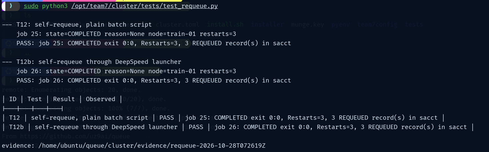
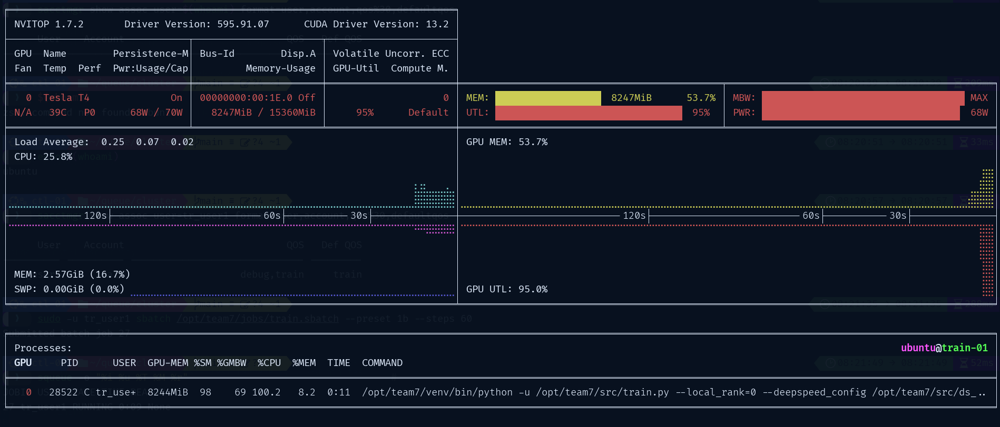
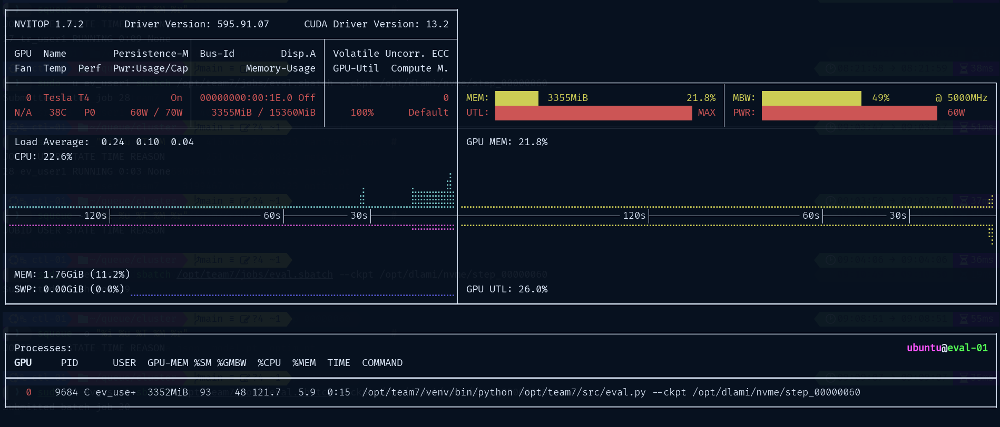
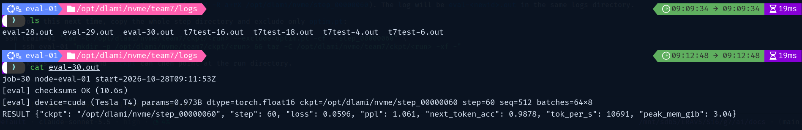

# Setting up SLURM 


Setup is designed for single (CPU) controller and two worker (GPU) nodes


On controller node
```
git clone https://github.com/uz9ai/queue
cd queue/cluster
cp cluster.example.toml cluster.toml
vi cluster.toml # *
```

* change IPs for the three nodes (tested with private IPs of EC2); also add SSH keys for users so that the relevant individuals can login to the controller node for job submission


```
chmod +x install.sh
./install.sh validate
./install.sh render
sudo ./install.sh controller
sudo cat /root/team7/munge.key > munge.key
```

Save cluster.toml and munge.key to local machine. these need to be copied to the worker nodes (important)


On train node

```
git clone https://github.com/uz9ai/queue
cd queue/cluster
chmod +x install.sh
sudo ./install.sh node train-01 --munge-key munge.key
```


[](https://www.youtube.com/embed/eAEDIqa-4ao)  

On eval node
```
git clone https://github.com/uz9ai/queue
cd queue/cluster
chmod +x install.sh
sudo ./install.sh node eval-01 --munge-key munge.key
```


[](https://www.youtube.com/embed/EMpvmDYUiMc)

Go back to controller node to verify

```
sudo ./install.sh verify
```

### Testing (Optional)

Various test (on controller node)
```
sudo python3 /opt/team7/cluster/tests/test_limits.py  # ~2 minutes
sudo python3 /opt/team7/cluster/tests/test_requeue.py # ~30 minutes
```


[](https://www.youtube.com/embed/SOj4qid-9to)





## Run training


From local machine (whoever has ssh keys added to the train user 1 can run

```
ssh tr_user1@controller
sbatch /opt/team7/jobs/train.sbatch --preset 1b --steps 30
```


for testing purposes, on the controller node, you can run

```
sudo -u tr_user1 sbatch /opt/team7/jobs/train.sbatch --preset 1b --steps 60
```


[](https://www.youtube.com/embed/nqgZozMuxLM)

## Run evaluation


For now,the checkpoint has to be manually copied between the two nodes. This will update depending on the shared storage option
From local machine (whoever has ssh keys added to the eval user 1 can run

```
ssh ev_user1@controller
sbatch /opt/team7/jobs/ev_user1.sbatch --ckpt /opt/dlami/nvme/step_00000060
```



for testing purposes, on the controller node, you can run

```
sudo -u ev_user1 sbatch /opt/team7/jobs/eval.sbatch --ckpt /opt/dlami/nvme/step_00000060
```





